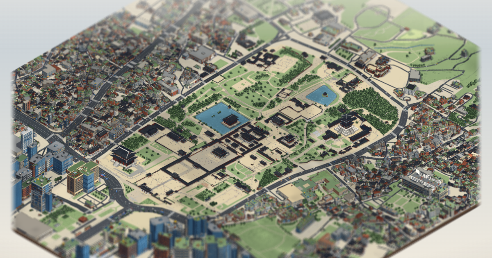

# 서울 미니어처: 경복궁과 여의도

서울의 두 동네를 실제 지도 배치 그대로 옮긴 픽셀아트 미니어처입니다. **경복궁** 일대(약 1.4 km × 0.85 km)와 한강을 낀 **여의도**(약 2.8 km × 1.7 km, 밤섬 포함)가 있습니다.
시간·계절·날씨가 바뀌고 사람과 차가 움직입니다. 확대하면 그림이 경복궁은 6.25 cm/px, 여의도는 12.5 cm/px 까지 세밀해집니다. 개인 비상업 연구 프로젝트입니다.

**보기**

- 경복궁: https://midagedev.github.io/seoul-miniature/
- 여의도: https://midagedev.github.io/seoul-miniature/?map=yeouido



*A pixel-art miniature of two Seoul neighbourhoods, the Gyeongbokgung Palace district and Yeouido on the Han River (open it with `?map=yeouido`). Each map is laid out from open map data as a Blender 3D scene, rendered with one fixed orthographic camera, restyled window by window with an Apache-2.0 image-edit model (Qwen-Image-Edit-2511 + Lightning LoRA), checked back against the render to undo what the model invented, and animated in the browser with WebGL2. This repository contains the viewer, the scripts that made the current pictures (`pipeline3d/`), the exact prompts, and notes on how to do the same for another place. Pictures CC BY 4.0, scene data and Blender files ODbL (also as glTF, plus one glTF per Yeouido landmark), code MIT — reuse them freely with attribution (docs/REUSE.md). Documentation is in Korean.*

## 어떻게 만들었나

1. **배치는 공개 데이터에서.** OpenStreetMap 의 건물 윤곽·높이 태그·도로·교량·수면·녹지·담·나무로 Blender 3D 장면을 코드로 세웁니다. 경복궁 일대는 국토교통부 건물 높이를 더했고, 전각 46건은 국가유산청이 공공누리 제1유형으로 개방한 3D 기록의 형태를 배치했습니다.
2. **랜드마크는 사진을 보고 모델링.** 63빌딩·파크원·국회의사당 같은 건물은 자유 라이선스 사진을 여러 각도로 눈으로 보고 따로 만들었습니다. 사진은 모델에 넣지 않았습니다.
3. **고정 카메라로 조건 렌더.** 정사투영 카메라 하나(35° 내려다봄, 경복궁은 북서쪽·여의도는 남쪽을 봄)로 색·물체 ID·깊이를 22016 × 13568 px 캔버스에 렌더합니다.
4. **양식만 이미지 모델로.** 색 렌더를 1408 × 1024 px 창 270개(겹침 128 px)로 나눠, 창마다 그 창에 있는 것만 말하는 프롬프트로 다시 그립니다. 창들이 잠재값 하나를 함께 써서 이음매가 거의 없습니다. GPU 3장으로 지도 하나에 약 1시간(경복궁 67분, 여의도 59분) 걸렸습니다.
5. **지어낸 것 되돌리기.** 모델은 빈 마당·강물·다리 위에 건물을 지어냅니다. 조건 렌더를 정답지로 그런 곳을 찾아 다시 칠합니다(여의도에서 지어낸 건물 497개 → 4개). 옥상과 랜드마크 벽은 렌더를 그대로 씁니다.
6. **줄이고 자르기.** 128색으로 줄이고 확대 단계별 256 px 타일로 자릅니다(지도당 약 6천 장, 90 MB 안팎). 같은 렌더의 깊이·ID 로 가림 판정용 깊이 맵과 분류 맵을 만듭니다.
7. **브라우저에서 살리기.** WebGL2 뷰어가 깊이 맵으로 차와 사람을 건물 뒤에 가리고, 분류 맵으로 나무 흔들림·물결·창문 불빛·구름 그림자·눈비를 셰이더에서 만듭니다. 사람·차·새는 코드로 그립니다.

## 따라 해 보기

| 읽을 것 | 내용 |
|---|---|
| [docs/PIPELINE.md](docs/PIPELINE.md) | 단계별 입력·출력·숫자·이유, 다른 지역에 적용하는 점검표 |
| [docs/PROMPTS.md](docs/PROMPTS.md) | 이미지 모델 프롬프트 원문과 조립 규칙, 판마다 바꾼 이유, Claude Code 에 한 지시 원문 |
| [docs/LESSONS.md](docs/LESSONS.md) | 안 됐던 것과 그 이유(3D 판, 이전 2D 판) |
| [pipeline3d/README.md](pipeline3d/README.md) | 지금 그림을 만든 스크립트, 환경 변수, 입력 자료 받는 곳, 실행 순서 |
| [docs/APP.md](docs/APP.md) | 뷰어 구조, 자산 형식, 주소 옵션 |
| [docs/REUSE.md](docs/REUSE.md) | 그림·장면·코드를 가져다 쓰는 조건, 그대로 복사하는 출처 문구, 용도별 안내 |
| [docs/LICENSING.md](docs/LICENSING.md) | 공개 전 라이선스 점검 방법과 결정 기록 |
| [docs/PIPELINE-2D-legacy.md](docs/PIPELINE-2D-legacy.md) | 이전 판(2D 색 블록 밑그림) 절차. `pipeline/` 의 도구가 이 판의 것 |

새 동네로 해 보려면 `pipeline3d/yeouido/` 경로를 본으로 삼으세요. OSM 받기부터 굽기까지 이어집니다. 입력 데이터(OSM 원본, 국가유산청 3D, 중간 렌더)와 모델 가중치는 이 저장소에 없습니다.

## 이 저장소에 있는 것

| 경로 | 내용 |
|---|---|
| `index.html`, `style.css`, `src/` | 뷰어. 빌드 없이 그대로 열리는 ES 모듈(WebGL2). GitHub Pages 가 저장소 루트를 그대로 서빙합니다 |
| `assets/` | 뷰어가 쓰는 그림 타일·깊이·분류 맵과 장면 데이터(경복궁 `redraw/`·`web-poc/`, 여의도 `yeouido/`) |
| `test/` | 교통·사람 시뮬레이션, 투영, 타일, PNG 디코더, 밤 창문, 지도 전환의 `node --test` 테스트 |
| `pipeline3d/` | 지금 그림을 만든 스크립트: 3D 장면·조건 렌더(Blender `bpy`), 양식 패스(ComfyUI 조정자·워커), 굽기 |
| `pipeline/` | 이전 판 그림을 만든 도구(OSM 받기 → 색 블록 밑그림 → 타일 생성 → 검사 → 병합) |
| `docs/` | 위 "따라 해 보기"의 문서들 |
| `CREDITS.md`, `LICENSE` | 출처와 라이선스 |

## 바로 실행

```bash
git clone https://github.com/midagedev/seoul-miniature && cd seoul-miniature
node serve.mjs 5173        # http://127.0.0.1:5173/  (의존성 없음), 여의도는 /?map=yeouido
npm install && npm test    # 테스트를 돌릴 때만
```

주소 옵션: `?map=yeouido` 여의도 · `?res=1` 절반 해상도 그림 · `?cars=150` 차량 수 · `?tilt=0` 미니어처 흐림 끄기 · `?tour` 자동 둘러보기 · `?clean` UI 숨김 ·
`#x,y,높이` 특정 위치로 바로 열기(화면 아래 「링크 복사」가 만들어 줍니다). 전체 목록은 [docs/APP.md](docs/APP.md).

## 한계

- 그림은 지도마다 정지 그림 한 벌입니다. 카메라는 돌릴 수 없고, 확대·이동만 됩니다.
- 양식 패스는 창 단위라서 창 경계에서 그림체가 조금 달라지는 곳이 있습니다. 모델이 지어낸 작은 소품이 남아 있을 수 있습니다.
- 가림 판정은 깊이 맵 한 장으로 합니다. 다리 밑이나 처마 밑처럼 겹친 곳에서는 틀릴 수 있습니다.
- 교통은 연출입니다. 경복궁은 신호와 차로를 따르고, 여의도는 신호 없이 차로만 따릅니다. 실제 교통량·신호 주기와는 무관합니다.
- 휴대폰에서는 화면 크기와 메모리에 맞춰 낮은 확대 단계의 타일을 씁니다. 기기별 프레임 속도는 측정해 공개한 값이 없습니다.

## 사실성에 대해

건물 배치는 공개 지도 데이터 기반이지만 측량 수준이 아닙니다. 여의도 건물 높이는 OSM 태그가 없으면 건물 종류와 면적으로 추정했습니다. 국가유산청 기록을 쓴 경복궁 전각 46건과 사진을 보고 만든 랜드마크 외의 파사드·지붕·창문·수목은 절차적으로 만들거나 AI 가 그린 장식이고, 사람과 차는 연출입니다.
지도로 쓰지 마세요.

## 가져다 쓰기

그림·타일·영상·스크린샷은 **CC BY 4.0**, 장면 데이터(`scene.json`, `map.json`)와 3D 장면(`.blend`, `.glb`)은 **ODbL 1.0**, 코드는 **MIT** 입니다. 영상·글·인쇄물·굿즈·게임에 써도 되고 고쳐서 다시 내도 됩니다(프로젝트는 비상업이지만 그림의 상업 이용도 허용합니다). 이 프로젝트와 원천(OpenStreetMap, 경복궁이면 국가유산청)을 함께 표시해 주세요.
3D 장면(Blender `.blend`, 게임 엔진·웹용 `.glb`, 여의도 랜드마크별 `.glb`)은 파일이 커서 [Releases](https://github.com/midagedev/seoul-miniature/releases)에 있습니다. 경복궁 장면에는 국가유산청 모델 대신 대체 모형이 들어 있고, 직접 받은 모델을 끼우는 스크립트가 있습니다.
복사해 쓰는 출처 문구, 용도별 안내, 실제 건물 생김새에 관한 주의는 [docs/REUSE.md](docs/REUSE.md).

## 출처와 라이선스

지도 데이터 © [OpenStreetMap contributors](https://www.openstreetmap.org/copyright) (ODbL) · Overture Maps Foundation · 국토교통부 GIS건물통합정보 · 국가유산청 경복궁 3D 기록(공공누리 제1유형) · 그림 Qwen-Image-Edit-2511 + Lightning 8-step LoRA (Apache-2.0).
위 기관·단체가 이 작업을 후원하거나 보증한 것은 아닙니다.

- 전체 출처와 조건: [CREDITS.md](CREDITS.md)
- 코드는 MIT, 그림은 CC BY 4.0, 장면 데이터는 ODbL: [LICENSE](LICENSE), 쓰는 법은 [docs/REUSE.md](docs/REUSE.md)
- 공개 전에 라이선스를 어떻게 점검했는지: [docs/LICENSING.md](docs/LICENSING.md)
